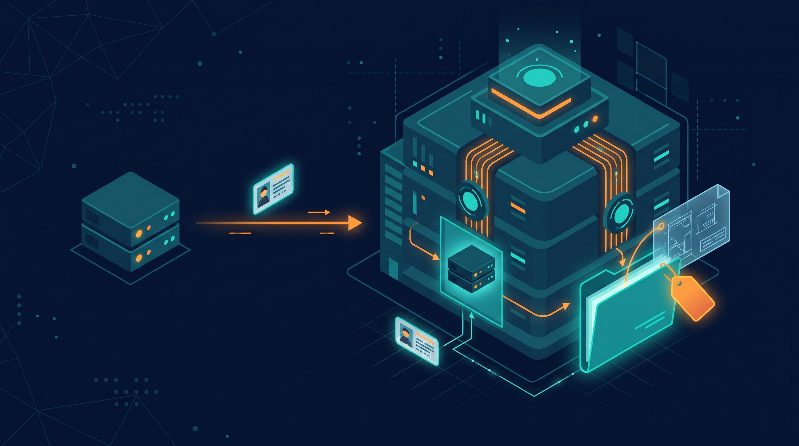

# OSY 2026 – Zabbix 8.0 LTS auto-registrace agenta (Debian 13)

Vagrant vytvoří VM s Debianem 13, nainstaluje **Zabbix Agent 2 8.0 LTS** z oficiálního repozitáře Zabbix
a nastaví ho tak, aby se sám zaregistroval na server `enceladus.pfsense.cz` (aktivní auto-registrace, `HostMetadata=SPOS`).
Vše proběhne automaticky při `vagrant up`, uvnitř VM se nic neinstaluje ručně.

| | |
|---|---|
| Box | `bento/debian-13` (202510.26.0) |
| Agent | `zabbix-agent2` 8.0.0 (`2:8.0.0-1+debian13`) z `repo.zabbix.com/zabbix/8.0` |
| Server | `enceladus.pfsense.cz`, port 10051 (aktivní kontroly) |
| Můj host | `rozensky-debian-aac0b2e7fa65` |

## Soubory

| Soubor | Co dělá |
|---|---|
| `Vagrantfile` | VM `bento/debian-13`, 1 CPU, 1 GB RAM, spouští oba skripty jako provisioning |
| `install-zabbix8-agent2.sh` | přidá oficiální repozitář Zabbix 8.0 pro Debian 13, nainstaluje `zabbix-agent2`, ověří verzi 8.0 |
| `configure-zabbix8-agent2.sh` | vytvoří trvalý unikátní `Hostname`, nastaví `Server`, `ServerActive`, `HostMetadata`, `Timeout`, spustí službu |
| `.gitattributes` | vynutí unixové konce řádků (LF) u skriptů, jinak by bash ve VM spadl na `\r` |
| `.gitignore` | nenahrává složku `.vagrant/` se stavem VM |

## Spuštění

```bash
git clone https://github.com/sposdknl/ladarozensky-wq-osy-2026-zbx8-auto-reg.git
cd ladarozensky-wq-osy-2026-zbx8-auto-reg
vagrant up
```

## Jak to funguje

1. **Instalace:** skript stáhne balíček `zabbix-release_latest+debian13_all.deb`, který do systému přidá repozitář
   Zabbix 8.0 a jeho GPG klíč. Pak `apt` nainstaluje `zabbix-agent2` a skript zkontroluje, že je to opravdu verze 8.0
   (ne starší balíček z repozitáře Debianu). Repo se přidává jen jednou, při dalším provisioningu se krok přeskočí.
2. **Unikátní hostname:** při prvním provisioningu se vygeneruje jméno `rozensky-debian-` + 12 náhodných hex znaků
   a uloží se do `/var/lib/spos-zabbix/hostname`. Při restartu VM ani při dalším provisioningu se nemění,
   skript ho jen přečte. Díky tomu na serveru nevzniká duplicitní host.
3. **Konfigurace:** z `/etc/zabbix/zabbix_agent2.conf` se smažou staré řádky `Server`, `ServerActive`, `Hostname`,
   `HostMetadata` a `Timeout` a připíšou se nové. Díky tomu se hodnoty při opakovaném běhu nezdvojují.
4. **Auto-registrace:** VM je za NAT, server se k ní nedostane, proto se používají aktivní kontroly.
   Agent se sám připojí na `enceladus.pfsense.cz:10051` a pošle svůj `Hostname` a `HostMetadata=SPOS`.
   Server hosta podle pravidla pro `SPOS` vytvoří, přiřadí mu skupinu, štítek a šablonu pro Linux a začne přijímat data.

## Ověření

```bash
vagrant ssh
zabbix_agent2 -V                                   # zabbix_agent2 (Zabbix) 8.0.0
systemctl status zabbix-agent2                     # active (running)
grep -E '^(Server|ServerActive|Hostname|HostMetadata|Timeout)=' /etc/zabbix/zabbix_agent2.conf
sudo tail -f /var/log/zabbix/zabbix_agent2.log
```

Výpis z logu agenta po prvním spuštění (časy v UTC):

```
07:24:25 Zabbix Agent2 hostname: [rozensky-debian-aac0b2e7fa65]
07:24:27 no active checks on server [enceladus.pfsense.cz:10051]: host [rozensky-debian-aac0b2e7fa65] not found
07:24:41 active checks on server are active again
```

Při prvním kontaktu server hosta ještě nezná (`not found`), spustí auto-registraci a za 14 sekund už agent posílá data.

Opakovaný provisioning a restart, hostname musí zůstat stejný:

```bash
vagrant reload --provision
```

## Výsledek

Host `rozensky-debian-aac0b2e7fa65` se zaregistroval, má přiřazenou skupinu, štítek a linuxovou šablonu a odesílá data.





## Problémy během práce

| Problém | Příčina | Řešení |
|---|---|---|
| Provisioning skončil hned po instalaci agenta bez chybové hlášky | `zabbix_agent2 -V \| head -n1`: `head` po prvním řádku zavřel rouru, agent dostal SIGPIPE (kód 141) a `set -o pipefail` ukončil skript | `head -n1` nahrazeno `awk 'NR==1'`, které přečte celý výstup |
| Configure skript volal `rpm: command not found` | při stahování se přepsal soubor verzí pro Fedoru se stejným názvem | nahrazen správným souborem, ověřeno přes `findstr` |
| Host availability v Zabbixu ukazuje *Unknown* | pasivní kontroly (server → agent, port 10050) přes NAT neprojdou | v pořádku, monitoring běží přes aktivní kontroly |

Poznámka: server `enceladus.pfsense.cz` běží na Zabbixu 7.0 (frontend 7.0.32), agent je 8.0. V aktivním režimu spolu fungují bez problémů.

## Dokumentace

- [Zabbix 8.0 – instalace z balíčků](https://www.zabbix.com/documentation/8.0/en/manual/installation/install/packages)
- [Zabbix 8.0 – auto-registrace aktivního agenta](https://www.zabbix.com/documentation/8.0/en/manual/discovery/auto_registration)
- [Zabbix 8.0 – parametry Zabbix agent 2](https://www.zabbix.com/documentation/8.0/en/manual/concepts/agent2/agent2_params)